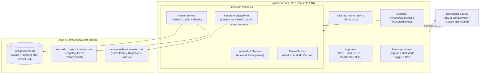

# 🤖 AGENTS.md — Guía Maestra de Arquitectura, Operación y Desarrollo

> **Documento Oficial para Agentes de IA y Desarrolladores**  
> **Proyecto:** Portal Interactivo Amigo Secreto 2026  
> **Fecha de Actualización:** Noviembre 2026  
> **Puerto Local de Ejecución:** `http://localhost:5222`  
> **Rama de Trabajo:** `develop`

---

## 📋 1. Resumen Ejecutivo y Propósito

El **Portal Interactivo Amigo Secreto 2026** es una plataforma web corporativa desarrollada con **Blazor Interactive Server** (.NET 10) y **SQLite**, creada para gestionar el intercambio navideño de regalos de 51 colaboradores.

La plataforma permite a cada participante ingresar de forma segura, personalizar su ficha (foto de perfil, preferencias de gustos, cosas a evitar, alergias, tallas de ropa y calzado, y múltiples propuestas de regalo con fotos y enlaces), explorar el directorio de compañeros mediante un carrusel de filtros por departamento, consultar el cronograma oficial de fechas de entrega de regalos integrado en el banner principal, visualizar fichas en paneles deslizantes interactivos con carrusel de propuestas y descargar fichas formateadas en alta resolución generadas dinámicamente mediante HTML5 Canvas.

### 🎯 Principios Clave del Sistema:
1. **Identidad Neutral y Festiva**: Colores corporativos basados en Azul Marino Profundo (`#002855`) y Naranja Festivo (`#FF6600`), sin logotipos ni referencias a entidades financieras externas (removida toda mención a BNC o Banco Nacional de Crédito).
2. **Persistencia Híbrida Cero Pérdidas**: Sincronización continua entre SQLite (`amigosecreto.db`), archivos `.txt` en Base64 en disco (`ImagenesParticipantes/`), memoria RAM en tiempo de ejecución (`ConcurrentDictionary`) y un respaldo maestro en JSON (`respaldo_base_de_datos.json`).
3. **Modo Oscuro Permanente**: Persistido mediante una cookie del navegador (`app_theme`) válida por 1 año, inmune al vaciado de caché y con renderizado en servidor (SSR) que previene destellos de pantalla blanca (*anti-FOUC*).
4. **Seguridad y Soporte**: Cambio de clave obligatorio en el primer ingreso de cualquier colaborador, mensaje de contacto unificado ante errores de acceso (`EXT 0523 ó 0545`), y mecanismo de restablecimiento de base de datos protegido en 2 fases con confirmación crítica.

---

## 🏛️ 2. Arquitectura General del Sistema



---

## 🗃️ 3. Modelo de Dominio y Base de Datos

### 3.1 Entidad `Person` ([`Models/Person.cs`](file:///c:/Repositories/Antigravity/AmigoSecreto/Models/Person.cs))

Representa a cada colaborador participante en el Amigo Secreto:

| Campo | Tipo | Mapeado EF | Descripción |
|---|---|:---:|---|
| `Id` | `int` | Sí (PK) | Identificador autoincremental de base de datos. |
| `FirstName` | `string` | Sí | Nombre del participante (obligatorio, máx 60 caracteres). |
| `LastName` | `string` | Sí | Apellido del participante (obligatorio, máx 60 caracteres). |
| `Username` | `string` | Sí | Nombre de usuario único para inicio de sesión. |
| `Password` | `string` | Sí | Contraseña personalizada o autogenerada. |
| `Email` | `string?` | Sí | Correo electrónico (dominio oficial `@amigosecreto.local`). |
| `Department` | `string?` | Sí | Departamento o área de trabajo para filtrado. |
| `ShirtSize` | `string?` | Sí | Talla de camisa/franela (ej. S, M, L, XL). |
| `ShoeSize` | `string?` | Sí | Talla de calzado (ej. 38, 40, 42). |
| `FavoriteColor` | `string?` | Sí | Color o gama favorita del participante. |
| `AvatarColor` | `string?` | Sí | Color hexadecimal de fondo para las iniciales del avatar. |
| `ProfilePhotoPath` | `string?` | Sí | Endpoint virtual de la foto en memoria (`/imagenes-memoria/{Nombre_Apellido}/perfil`). |
| `GiftImagePath` | `string?` | Sí | Endpoint de la imagen principal del regalo deseado. |
| `GiftReferenceUrl` | `string?` | Sí | JSON serializado con el array de propuestas de regalo (`List<GiftProposal>`). |
| `Likes` | `string` | Sí | Lista de artículos que le agradan (separados por líneas/comas). |
| `Dislikes` | `string` | Sí | Lista de cosas que prefiere evitar o que NO le gustan. |
| `Allergies` | `string` | Sí | Alergias, intolerancias alimentarias o restricciones de salud. |
| `Notes` | `string?` | Sí | Mensaje especial o sugerencia para su Amigo Secreto. |
| `CreatedAt` / `UpdatedAt` | `DateTime` | Sí | Auditoría de creación y última actualización. |
| `FullName` | `string` | No (`[NotMapped]`) | Propiedad calculada: `FirstName + " " + LastName`. |
| `Initials` | `string` | No (`[NotMapped]`) | Iniciales en mayúsculas (ej. `George Embaid` -> `GE`). |
| `RequiresPasswordChange` | `bool` | No (`[NotMapped]`) | `true` si la contraseña actual coincide con la clave por defecto (`{apellido}2026`). |
| `GiftProposalsList` | `List<GiftProposal>` | No (`[NotMapped]`) | Lista deserializada de propuestas de regalo activas. |

### 3.2 Clase `GiftProposal` ([`Models/Person.cs`](file:///c:/Repositories/Antigravity/AmigoSecreto/Models/Person.cs))

Permite a los colaboradores presentar **múltiples opciones o propuestas** de regalos deseados:

```csharp
[NotMapped]
public class GiftProposal
{
    public string Id { get; set; } = Guid.NewGuid().ToString("N")[..8];
    public string Description { get; set; } = string.Empty; // Breve descripción del artículo
    public string? ReferenceUrl { get; set; }               // URL de tienda (Amazon, MercadoLibre, etc.)
    public string? ImagePath { get; set; }                  // Endpoint de imagen referencial
    public bool HasContent => ...;
}
```

> [!IMPORTANT]
> `GiftProposal` **NO** es una tabla en la base de datos de EF Core (`[NotMapped]` y `modelBuilder.Ignore<GiftProposal>()` en `AppDbContext`). Se almacena de forma transparente y retrocompatible como una cadena JSON en la columna `GiftReferenceUrl` de la entidad `Person`.

---

## 🛡️ 4. Capa de Seguridad y Autenticación

### 4.1 Login Unificado en Página Principal (`/`)
- La página [`Home.razor`](file:///c:/Repositories/Antigravity/AmigoSecreto/Components/Pages/Home.razor) cuenta con una única pantalla de acceso:
  - **Si ingresa un Administrador** (`admin` / `admin2026` o fallback `bnc2026`): se autentica en [`AdminAuthService`](file:///c:/Repositories/Antigravity/AmigoSecreto/Services/AdminAuthService.cs), redirige a `/admin` y habilita la navegación libre entre el Directorio y el Panel de Control.
  - **Si ingresa un Participante**: se verifica contra la base de datos SQLite. Al iniciar sesión, se le asocia como `CurrentParticipant`.

### 4.2 Política de Cambio de Clave Obligatorio
- **Detección Automática**: Al autenticarse un participante, `Person.RequiresPasswordChange` evalúa si el usuario aún posee la contraseña generada por defecto (`{apellido}2026`).
- **Bloqueo de Interfaz**: Si `RequiresPasswordChange == true`, el portal despliega inmediatamente la tarjeta modal **"Seguridad de Acceso • Primer Ingreso: Cambio de Clave Obligatorio"**, impidiendo continuar hasta que ingrese y confirme su nueva contraseña personal.
- **Soporte Telefónico Unificado**: Si un participante introduce credenciales incorrectas, el sistema muestra textualmente la instrucción corporativa:  
  `"Usuario o contraseña incorrectos. Si no recuerda la contraseña comuniquese con las EXT 0523 ó 0545"`.

### 4.3 Acceso de Administrador (`/admin`)
- **Usuario:** `admin`
- **Contraseña:** `admin2026`
- **Capacidades del Administrador:**
  - Métricas globales en tiempo real (participantes con foto, con gustos, con alergias).
  - Búsqueda y filtrado avanzado por departamento.
  - CRUD total: Creación de participantes, edición integral y eliminación con modal de confirmación.
  - Visualización y cambio directo de credenciales de cualquier participante que lo solicite.
  - Botón protegido de **Restablecimiento de Participantes**: Oculto por defecto mediante un botón de activación (`showResetButton`). Al pulsarlo, requiere confirmación en **2 fases** (paso 1 de advertencia y paso 2 de confirmación crítica definitiva).

---

## 💾 5. Estrategia de Almacenamiento Híbrido Cero Pérdidas

A fin de evitar pérdida de datos si el proceso o el servidor se reinician, el sistema utiliza 4 niveles integrados:

```
[Cliente / Blazor UI]
       │
       ▼
1. ImageStorageService (Memoria RAM: ConcurrentDictionary)
       │
       ├──► 2. Disco Local: ImagenesParticipantes/{Nombre}_{Apellido}.txt (Base64)
       │
3. AppDbContext (SQLite: amigosecreto.db con Pooling=False y WAL TRUNCATE)
       │
       └──► 4. Respaldo JSON: ImagenesParticipantes/respaldo_base_de_datos.json
```

1. **SQLite (`amigosecreto.db`)**:
   - Cadena de conexión con `Pooling=False` para forzar la escritura inmediata a disco sin bloqueos residuales.
   - Modo de sincronización `PRAGMA synchronous = FULL` y vaciado de registro de transacciones con `PRAGMA wal_checkpoint(TRUNCATE)`.
2. **Archivos `.txt` de Imágenes en Disco (`ImagenesParticipantes/`)**:
   - Cada participante tiene un archivo `{Nombre}_{Apellido}.txt` estructurado con etiquetas `[PROFILE]` y `[GIFT]`.
   - Si se edita una foto, se reescribe el archivo `.txt` y se actualiza la memoria instantáneamente.
3. **Servicio en Memoria (`ImageStorageService.cs`)**:
   - Implementa endpoints HTTP virtuales mapeados en `Program.cs`:
     - `/imagenes-memoria/{name}/perfil`
     - `/imagenes-memoria/{name}/regalo`
     - `/imagenes-memoria/{name}/regalo-{index}`
   - Garantiza que las imágenes carguen de inmediato sin latencia de disco.
4. **Respaldo Maestro JSON (`respaldo_base_de_datos.json`)**:
   - En cada operación de guardado o actualización en [`PersonService.cs`](file:///c:/Repositories/Antigravity/AmigoSecreto/Services/PersonService.cs), se serializa la lista completa de colaboradores a este archivo JSON. Si la base SQLite estuviera vacía al arrancar, el inicializador restaura automáticamente todos los datos desde este respaldo.

---

## 🌓 6. Sistema de Modo Oscuro con Cookie Persistente

El modo oscuro cumple estrictamente los requisitos de retención permanente en el navegador:

### 6.1 Persistencia mediante Cookie (`app_theme`)
- **Nombre de la Cookie:** `app_theme`
- **Valores posibles:** `"dark"` o `"light"`
- **Vigencia:** 31,536,000 segundos (1 año exacto) con directiva `SameSite=Lax` y ruta global `path=/`.
- **Inmunidad al Borrado de Caché:** El borrado estándar de caché en Chrome, Firefox o Edge ("Archivos e imágenes en caché") no borra las cookies, manteniendo intacta la preferencia del usuario.

### 6.2 Detección en Servidor y Eliminación de Destello (*Anti-FOUC*)
1. **Renderizado SSR en [`App.razor`](file:///c:/Repositories/Antigravity/AmigoSecreto/Components/App.razor)**:
   ```csharp
   [CascadingParameter] private HttpContext? HttpContext { get; set; }
   @inject IHttpContextAccessor HttpContextAccessor

   private string CurrentTheme => 
       (HttpContextAccessor.HttpContext?.Request.Cookies["app_theme"] 
        ?? HttpContext?.Request.Cookies["app_theme"]) == "dark" 
           ? "dark" 
           : "light";
   ```
   El elemento raíz `<html lang="es" data-theme="@CurrentTheme" class="@(CurrentTheme == "dark" ? "dark-theme" : "")">` se envía desde el servidor con el tema ya aplicado.
2. **Script Instantáneo en `<head>`**:
   Comprueba `document.cookie` inmediatamente para garantizar cero discrepancias antes del pintado del DOM.
3. **Servicio Reactivo C# ([`ThemeService.cs`](file:///c:/Repositories/Antigravity/AmigoSecreto/Services/ThemeService.cs))**:
   Permite a cualquier componente C# suscribirse al evento `OnThemeChanged` para adaptar tipografías y colores en tiempo real.
4. **Botón en Navbar ([`MainLayout.razor`](file:///c:/Repositories/Antigravity/AmigoSecreto/Components/Layout/MainLayout.razor))**:
   Conmuta el tema dinámicamente llamando a `window.themeManager.toggleTheme()`, alternando entre el icono del Sol ☀️ y la Luna 🌙.

---

## 🎨 7. Generador de Imagen de Resumen (`summaryImageGenerator.js`)

Ubicado en [`wwwroot/js/summaryImageGenerator.js`](file:///c:/Repositories/Antigravity/AmigoSecreto/wwwroot/js/summaryImageGenerator.js):
- **Propósito:** Genera una imagen PNG descargable con la ficha completa del colaborador (foto de perfil, iniciales, proposals de regalos deseados con imágenes, gustos, no me gusta, alergias, tallas y notas).
- **Diseño Adaptativo Extremo:** Si el usuario tiene una cantidad masiva de gustos o restricciones (desde 1 hasta más de 500 me gusta o 100 alergias), el generador calcula automáticamente la geometría del lienzo canvas:
  - Expande el ancho hasta 1900px y distribuye los datos en **5 columnas paralelas** para evitar desbordamientos.
  - Ajusta el tamaño de fuente y altura de línea dinámicamente.
- **Identidad Gráfica:** Encabezado con degradado azul marino y acento naranja festivo, badge decorativo `🎁` y pie de página neutral: `"Portal Interactivo • Amigo Secreto 2026"`.

---

## 🗺️ 7.1 Mapa Interactivo de la Oficina (`OfficeMapModal.razor`)

Modal interactivo para la distribución arquitectónica de los 51 colaboradores:
- **Plano Vectorial Interactivo 2.0:** Renderiza cada puesto de trabajo con la foto de perfil en miniatura o iniciales del colaborador, nombre, indicador de gustos/regalos cargados y halo luminoso interactivo al seleccionar o buscar.
- **Zonas Mapeadas:** Planta Baja (PB - Jhon Erice), Sector Oeste (ATM / POS), Mesón Central & Mesón Norte, Área Contact Center, 11 Islas de Mesas en Fila Sur y Barra Perimetral Sur.
- **Inspector de Puesto Flotante:** Al hacer clic en cualquier escritorio, despliega la ficha del colaborador con acceso directo de un clic a su detalle completo de gustos y propuestas (`PersonDetailModal`).
- **Modo Dual:** Alternador entre el Plano Interactivo 2.0 y el diagrama escaneado original (`mapa_oficina.png`) con zoom libre.
- **Filtros Rápidos y Búsqueda:** Búsqueda en tiempo real con animación de pulso y pin `📍`, y píldoras de filtrado rápido por zona.

---

## 👥 8. Directorio Oficial de los 51 Participantes

Todos los participantes están pre-registrados en la base de datos con correos bajo el dominio `@amigosecreto.local`:

| # | Nombre Completo | Usuario | Contraseña Inicial | Correo Electrónico |
|:---:|---|---|---|---|
| 1 | Sarahy Barragán | `sbarragan` | `barragan2026` | `sbarragan@amigosecreto.local` |
| 2 | Wilmary Maduro | `wmaduro` | `maduro2026` | `wmaduro@amigosecreto.local` |
| 3 | Leonardo Chacón | `lchacon` | `chacon2026` | `lchacon@amigosecreto.local` |
| 4 | Alix Puello | `apuello` | `puello2026` | `apuello@amigosecreto.local` |
| 5 | Keynner Aguilar | `kaguilar` | `aguilar2026` | `kaguilar@amigosecreto.local` |
| 6 | Carlos Nuñez | `cnunez` | `nunez2026` | `cnunez@amigosecreto.local` |
| 7 | Sorianyely Morin | `smorin` | `morin2026` | `smorin@amigosecreto.local` |
| 8 | Pablo Barboza | `pbarboza` | `barboza2026` | `pbarboza@amigosecreto.local` |
| 9 | Jesús Gomes | `jgomes` | `gomes2026` | `jgomes@amigosecreto.local` |
| 10 | George Embaid | `gembaid` | `embaid2026` | `gembaid@amigosecreto.local` |
| 11 | Kevin Solorzano | `ksolorzano` | `solorzano2026` | `ksolorzano@amigosecreto.local` |
| 12 | Erick Adames | `eadames` | `adames2026` | `eadames@amigosecreto.local` |
| 13 | Julián Esteves | `jesteves` | `esteves2026` | `jesteves@amigosecreto.local` |
| 14 | Susana Escobar | `sescobar` | `escobar2026` | `sescobar@amigosecreto.local` |
| 15 | Jhon Erice | `jerice` | `erice2026` | `jerice@amigosecreto.local` |
| 16 | Jesús Noguera | `jnoguera` | `noguera2026` | `jnoguera@amigosecreto.local` |
| 17 | José Sanabria | `jsanabria` | `sanabria2026` | `jsanabria@amigosecreto.local` |
| 18 | Katherine Mendible | `kmendible` | `mendible2026` | `kmendible@amigosecreto.local` |
| 19 | Darwin García | `dgarcia` | `garcia2026` | `dgarcia@amigosecreto.local` |
| 20 | Gabriel Tagliafico | `gtagliafico` | `tagliafico2026` | `gtagliafico@amigosecreto.local` |
| 21 | Kervin Azuaje | `kazuaje` | `azuaje2026` | `kazuaje@amigosecreto.local` |
| 22 | Albert Rangel | `arangel` | `rangel2026` | `arangel@amigosecreto.local` |
| 23 | Rosbel Rodríguez | `rrodriguez` | `rodriguez2026` | `rrodriguez@amigosecreto.local` |
| 24 | Miguel Suarez | `msuarez` | `suarez2026` | `msuarez@amigosecreto.local` |
| 25 | Edinson Cabello | `ecabello` | `cabello2026` | `ecabello@amigosecreto.local` |
| 26 | Jesús Colina | `jcolina` | `colina2026` | `jcolina@amigosecreto.local` |
| 27 | Yldemaro Romero | `yromero` | `romero2026` | `yromero@amigosecreto.local` |
| 28 | Junior Romero | `jromero` | `romero2026` | `jromero@amigosecreto.local` |
| 29 | Rafael Lozano | `rlozano` | `lozano2026` | `rlozano@amigosecreto.local` |
| 30 | Andrés Parra | `aparra` | `parra2026` | `aparra@amigosecreto.local` |
| 31 | Yhusleika Molina | `ymolina` | `molina2026` | `ymolina@amigosecreto.local` |
| 32 | Victor Obelmejía | `vobelmejia` | `obelmejia2026` | `vobelmejia@amigosecreto.local` |
| 33 | Enrique Sanchez | `esanchez` | `sanchez2026` | `esanchez@amigosecreto.local` |
| 34 | Jonathan Colucci | `jcolucci` | `colucci2026` | `jcolucci@amigosecreto.local` |
| 35 | Michael Bastidas | `mbastidas` | `bastidas2026` | `mbastidas@amigosecreto.local` |
| 36 | Lileska Romero | `lromero` | `romero2026` | `lromero@amigosecreto.local` |
| 37 | Jose Manuel Quintal | `jquintal` | `quintal2026` | `jquintal@amigosecreto.local` |
| 38 | Jose Luis Reyes | `jreyes` | `reyes2026` | `jreyes@amigosecreto.local` |
| 39 | Greadary Garcia | `ggarcia` | `garcia2026` | `ggarcia@amigosecreto.local` |
| 40 | Sheyla Tovar | `stovar` | `tovar2026` | `stovar@amigosecreto.local` |
| 41 | Abraham Figueroa | `afigueroa` | `figueroa2026` | `afigueroa@amigosecreto.local` |
| 42 | Karilyn Carvajal | `kcarvajal` | `carvajal2026` | `kcarvajal@amigosecreto.local` |
| 43 | Nestor Villegas | `nvillegas` | `villegas2026` | `nvillegas@amigosecreto.local` |
| 44 | Gustavo Suarez | `gsuarez` | `suarez2026` | `gsuarez@amigosecreto.local` |
| 45 | Eduardo Lobo | `elobo` | `lobo2026` | `elobo@amigosecreto.local` |
| 46 | Pablo Romero | `promero` | `romero2026` | `promero@amigosecreto.local` |
| 47 | Yessika Mata | `ymata` | `mata2026` | `ymata@amigosecreto.local` |
| 48 | Alexander Diaz | `adiaz` | `diaz2026` | `adiaz@amigosecreto.local` |
| 49 | Zenon Avariano | `zavariano` | `avariano2026` | `zavariano@amigosecreto.local` |
| 50 | Tokio Franco | `tfranco` | `franco2026` | `tfranco@amigosecreto.local` |
| 51 | Luis Rendon | `lrendon` | `rendon2026` | `lrendon@amigosecreto.local` |

---

## 📂 9. Mapa del Proyecto y Archivos Críticos

```
c:\Repositories\Antigravity\AmigoSecreto\
├── Components/
│   ├── App.razor                    # Shell HTML raíz, SSR Cookie, scripts globales y nieve
│   ├── Routes.razor                 # Enrutador interactivo Blazor Server
│   ├── _Imports.razor               # Namespaces globales de Razor
│   ├── Layout/
│   │   ├── MainLayout.razor         # Barra superior, botón de Modo Oscuro, Nav y Footer
│   │   └── NavMenu.razor            # Menú de navegación
│   ├── Pages/
│   │   ├── Home.razor               # Login unificado, cambio de clave, directorio y filtros
│   │   ├── Admin.razor              # Panel administrativo CRUD, métricas y reset protegido
│   │   └── Error.razor              # Manejo de excepciones
│   └── Shared/
│       ├── BncLogo.razor            # Emblema festivo oficial (adaptativo a modo claro/oscuro)
│       ├── OfficeMapModal.razor     # Modal interactivo del mapa de la oficina con buscador y zoom
│       ├── PersonDetailModal.razor  # Drawer lateral con carrusel de propuestas y exportador PNG
│       ├── PersonEditModal.razor    # Modal de edición de perfil en 3 pestañas (Scrollable)
│       └── SvgIcon.razor            # Biblioteca de iconos SVG (sol, luna, regalo, candado, etc.)
├── Data/
│   ├── AppDbContext.cs              # DbContext de EF Core SQLite (Ignore<GiftProposal>)
│   └── DbInitializer.cs             # Inicializador, sanitizador de correos/notas y sembrador
├── ImagenesParticipantes/           # Almacenamiento persistente en disco
│   ├── {Nombre}_{Apellido}.txt      # Archivos de texto Base64 de fotos de perfil y regalos
│   └── respaldo_base_de_datos.json  # Respaldo JSON completo de la base de datos
├── Models/
│   └── Person.cs                    # Entidades Person y GiftProposal con helpers
├── Services/
│   ├── IAdminAuthService.cs         # Contrato de autenticación
│   ├── AdminAuthService.cs          # Implementación de sesión para Admin y Participantes
│   ├── IThemeService.cs             # Contrato de gestión de temas (Claro / Oscuro)
│   ├── ThemeService.cs              # Implementación reactiva con IHttpContextAccessor y JS
│   ├── IPersonService.cs            # Contrato de operaciones CRUD
│   ├── PersonService.cs             # Servicio de participantes con sincronización a JSON
│   ├── IImageStorageService.cs      # Contrato de almacenamiento de imágenes
│   └── ImageStorageService.cs       # Gestor de archivos .txt en memoria y endpoints HTTP
├── wwwroot/
│   ├── app.css                      # Estilos completos, paleta oficial y reglas de Dark Mode
│   ├── favicon.png                  # Icono de la aplicación
│   └── js/
│       └── summaryImageGenerator.js # Generador dinámico de fichas PNG en HTML5 Canvas
├── amigosecreto.db                  # Base de datos SQLite activa
├── Program.cs                       # Pipeline HTTP, inyección de dependencias y endpoints
├── AmigoSecreto.csproj              # Configuración del proyecto .NET 10
└── AGENTS.md                        # Este documento maestro
```

---

## ⚙️ 10. Guía Operativa para Agentes de IA y Desarrolladores

### 10.1 Compilación y Ejecución
Para garantizar estabilidad en Windows y evitar bloqueos por archivos en uso:

1. **Detener el proceso previo si está en ejecución**:
   ```powershell
   taskkill /IM AmigoSecreto.exe /F
   ```
2. **Compilar el proyecto (en el sandbox o local)**:
   ```powershell
   dotnet build AmigoSecreto.slnx
   ```
3. **Iniciar el servidor (fuera del sandbox para permitir acceso por navegador)**:
   ```powershell
   dotnet run --launch-profile http --no-build
   ```
   > El servidor escuchará en: **`http://localhost:5222`**

### 10.2 Reglas Críticas de Desarrollo
1. **Preservación Estricta de Datos**:
   - **NUNCA** elimines ni vacíes `amigosecreto.db` ni los archivos en `ImagenesParticipantes/`. Los usuarios reales cargan sus fotos y preferencias en esta base.
2. **Uso de `BypassSandbox: true`**:
   - Ejecuta `dotnet build` dentro del sandbox (`BypassSandbox: false`).
   - Ejecuta `taskkill /IM AmigoSecreto.exe /F` y el servidor `dotnet run` fuera del sandbox (`BypassSandbox: true` con `IsDaemon: true`).
3. **Control de Bloqueos de Archivos en Windows**:
   - Si `dotnet build` arroja `MSB3026: The process cannot access the file AmigoSecreto.exe`, significa que el servidor está corriendo en segundo plano. Aplica `taskkill /IM AmigoSecreto.exe /F` antes de compilar.
4. **Mapeo EF Core para Regalos**:
   - Si agregas propiedades a `GiftProposal`, mantenlas fuera del mapeo de EF (`[NotMapped]`). Toda la lista de propuestas se serializa en el campo de texto `GiftReferenceUrl`.
5. **Políticas de Identidad Visual**:
   - Mantén los colores corporativos: Azul Marino `#002855`, Naranja `#FF6600`, Fondo Claro Atenuado `#dbe4ee` (optimizado para contraste de tarjetas y visibilidad de los copos de nieve), Fondo Oscuro `#0b1120`, Tarjeta Oscura `#1e293b`.
   - No vuelvas a introducir referencias a BNC o Banco Nacional de Crédito en nombres de variables públicas, títulos o logotipos.
